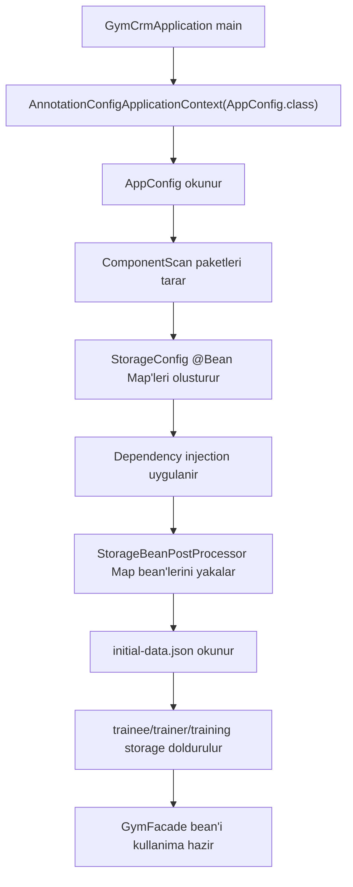

# Spring Core Container ve Bean Yasam Dongusu

## Bu Konunun Amaci

Bu notun amaci, projedeki Spring Core kullanimini ezberlenmis annotation bilgisi olarak degil, uygulamanin nasil ayaga kalktigini gosteren bir akil haritasi olarak anlamaktir.

Bu bolumu bitirdiginde sunlari aciklayabilmelisin:

- IoC container nedir ve neden kullanilir?
- `AnnotationConfigApplicationContext` ne yapar?
- `@Configuration`, `@ComponentScan`, `@Bean`, `@PropertySource`, `@Autowired`, `@Qualifier` hangi problemi cozer?
- Bu projede neden uc ayri `Map` bean'i vardir?
- `StorageBeanPostProcessor` hangi anda devreye girer?
- Baslangic JSON verisi Spring context acilirken storage bean'lerine nasil dolar?

## Buyuk Resim

Spring Core, uygulamadaki nesneleri manuel `new` ile daginik sekilde olusturmak yerine bir container icinde yonetir. Bu container, hangi siniflarin nesneye donusecegini, hangi nesnenin hangi bagimliliga ihtiyaci oldugunu ve uygulama kapanirken kaynaklarin nasil kapatilacagini bilir.

Bu projede container'in yaptigi ana isler sunlardir:

1. Configuration siniflarini okur.
2. `@ComponentScan` ile component, service, repository ve facade siniflarini bulur.
3. `StorageConfig` icindeki `@Bean` metotlarindan uc ayri storage `Map` olusturur.
4. `StorageBeanPostProcessor` ile bu `Map` bean'lerini JSON dosyasindan doldurur.
5. DAO, service, generator ve facade nesnelerinin bagimliliklarini inject eder.
6. `GymCrmApplication`, context'ten `GymFacade` bean'ini alip uygulama akisina baslar.

Kisa akil modeli:

```text
configuration -> bean definitions -> bean instances -> dependency injection -> post processors -> ready context
```

## Temel Spring Core Kavramlari

### IoC

IoC, "Inversion of Control" demektir. Kontrolun tersine cevrilmesi anlamina gelir.

Normalde bir sinif bagimliliklarini kendisi olusturabilir:

```java
TraineeDao dao = new TraineeDaoImpl();
TraineeService service = new TraineeServiceImpl();
```

Spring kullanildiginda nesneleri container olusturur ve bagimliliklari container baglar. Boylece siniflar "ben neye ihtiyac duyuyorum?" bilgisini verir, "bunu nasil olustururum?" sorumlulugunu container'a birakir.

### ApplicationContext

`ApplicationContext`, Spring container'in ana arayuzlerinden biridir. Bean'leri olusturur, saklar, bagimliliklari cozer ve uygulamaya hazir hale getirir.

Bu projede giris noktasi:

```java
new AnnotationConfigApplicationContext(AppConfig.class)
```

Bu satir, `AppConfig` sinifindan baslayarak Spring context'i kurar.

### Bean

Spring'in yonettigi nesneye bean denir.

Bu projedeki bean ornekleri:

- `GymFacade`
- `TraineeServiceImpl`
- `TrainerServiceImpl`
- `TrainingServiceImpl`
- `TraineeDaoImpl`
- `TrainerDaoImpl`
- `TrainingDaoImpl`
- `UniqueUsernameGenerator`
- `SecurePasswordGenerator`
- `StorageBeanPostProcessor`
- `traineeStorage`
- `trainerStorage`
- `trainingStorage`

### Component Scanning

`@ComponentScan("com.example.gymcrm")`, belirtilen paket altindaki Spring annotation'li siniflari bulur.

Ornek annotation'lar:

- `@Component`
- `@Service`
- `@Repository`
- `@Configuration`

Bu projede `GymFacade` `@Component`, servisler `@Service`, DAO implementasyonlari `@Repository`, generator ve initializer siniflari ise `@Component` olarak taranir.

### Java Configuration

`@Configuration`, bir sinifin bean tanimlari icerdigini gosterir.

Bu projede iki kritik configuration sinifi vardir:

- `src/main/java/com/example/gymcrm/config/AppConfig.java`
- `src/main/java/com/example/gymcrm/config/StorageConfig.java`

`AppConfig`, genel context ayarlarini yapar. `StorageConfig`, storage Map bean'lerini uretir.

### @Bean

`@Bean`, bir metodun dondugu nesnenin Spring bean'i olarak kaydedilecegini soyler.

Bu projede `StorageConfig` sunlari uretir:

```java
@Bean(StorageBeanNames.TRAINEE_STORAGE)
public Map<Long, Trainee> traineeStorage() {
    return new HashMap<>();
}
```

Buradaki onemli nokta: bean'in tipi sadece `Map` degil, adi da onemlidir. Cunku projede uc farkli `Map` vardir.

### @Autowired

`@Autowired`, Spring'in uygun bean'i otomatik baglamasini ister.

Bu projede setter injection sik kullanilir:

```java
@Autowired
public void setTraineeDao(TraineeDao traineeDao) {
    this.traineeDao = traineeDao;
}
```

Bu sayede servis, DAO implementasyonunu kendisi olusturmaz. Sadece `TraineeDao` interface'ine ihtiyac duydugunu belirtir.

### @Qualifier

Ayni tipten birden fazla bean varsa Spring hangisini inject edecegini bilemeyebilir.

Bu projede uc tane `Map` bean'i vardir:

- `traineeStorage`
- `trainerStorage`
- `trainingStorage`

Bu yuzden DAO'larda `@Qualifier` kullanilir:

```java
@Autowired
public void setStorage(@Qualifier(StorageBeanNames.TRAINEE_STORAGE) Map<Long, Trainee> storage) {
    initializeStorage(storage);
}
```

`@Qualifier`, "bana herhangi bir Map degil, adi traineeStorage olan Map'i ver" demektir.

### @PropertySource

`@PropertySource`, dis property dosyasini Spring environment'a ekler.

Bu projede:

```java
@PropertySource("file:${gym.config.path:config/application.properties}")
```

Bu ifade sunu soyler:

- Sistem property olarak `gym.config.path` verildiyse oradaki dosyayi oku.
- Verilmediyse `config/application.properties` dosyasini oku.

`config/application.properties` icinde:

```properties
storage.initial-data.path=config/initial-data.json
```

Bu deger `StorageBeanPostProcessor` icine `@Value` ile inject edilir.

## Bean Yasam Dongusu

Spring bean lifecycle'i bu proje icin sade sekilde soyle okunabilir:

1. Bean definition bulunur.
2. Bean instance olusturulur.
3. Bagimliliklar inject edilir.
4. Bean post processor'lar devreye girer.
5. Bean uygulama tarafindan kullanima hazir hale gelir.
6. Context kapanirken kaynaklar serbest birakilir.

Bu projede en onemli lifecycle noktasi `StorageBeanPostProcessor` sinifidir.

`StorageBeanPostProcessor`, `BeanPostProcessor` interface'ini implement eder ve `postProcessAfterInitialization` metodunu kullanir. Yani storage Map bean'i olusturulduktan sonra devreye girer.



## Bu Projede Nerede?

Bu konuyu takip etmek icin su dosyalari sirasiyla oku:

1. `src/main/java/com/example/gymcrm/application/GymCrmApplication.java`
2. `src/main/java/com/example/gymcrm/config/AppConfig.java`
3. `src/main/java/com/example/gymcrm/config/StorageConfig.java`
4. `src/main/java/com/example/gymcrm/config/StorageBeanNames.java`
5. `src/main/java/com/example/gymcrm/initializer/StorageBeanPostProcessor.java`
6. `src/main/java/com/example/gymcrm/initializer/InitialData.java`
7. `config/application.properties`
8. `config/initial-data.json`
9. `src/test/java/com/example/gymcrm/config/SpringContextIntegrationTest.java`
10. `src/test/java/com/example/gymcrm/initializer/StorageBeanPostProcessorTest.java`

## Kod Akisi

### 1. Uygulama context'i acar

`GymCrmApplication` icinde:

```java
try (AnnotationConfigApplicationContext context = new AnnotationConfigApplicationContext(AppConfig.class)) {
    GymFacade facade = context.getBean(GymFacade.class);
}
```

Burada `try-with-resources` kullanilmasi onemlidir. Context kapanirken Spring kaynaklari da kapatilir.

### 2. AppConfig temel ayarlari yukler

`AppConfig` sunlari yapar:

- `@Configuration` ile configuration sinifi olur.
- `@ComponentScan("com.example.gymcrm")` ile tum proje bean adaylarini tarar.
- `@PropertySource(...)` ile property dosyasini okur.
- `PropertySourcesPlaceholderConfigurer` bean'i ile `${...}` placeholder cozumunu aktif eder.

### 3. StorageConfig uc ayri Map uretir

`StorageConfig`, her entity icin ayri storage bean'i tanimlar:

- `Map<Long, Trainee>`
- `Map<Long, Trainer>`
- `Map<Long, Training>`

Bu ayrim task gereksiniminin dogrudan karsiligidir: her entity kendi in-memory storage alaninda tutulur.

### 4. StorageBeanNames magic string'i azaltir

Bean isimleri string olarak tekrar tekrar yazilsa yazim hatasi riski artardi. Bu yuzden bean isimleri tek yerde tutulur:

```java
public static final String TRAINEE_STORAGE = "traineeStorage";
```

DAO'lar ve post processor bu sabitleri kullanir.

### 5. StorageBeanPostProcessor Map bean'lerini doldurur

`postProcessAfterInitialization` her bean icin cagrilir. Sinif once bean'in `Map` olup olmadigina bakar.

Sonra bean adina gore karar verir:

- `traineeStorage` ise trainee listesini doldurur.
- `trainerStorage` ise trainer listesini doldurur.
- `trainingStorage` ise training listesini doldurur.
- Baska bir bean ise dokunmadan geri doner.

Bu tasarim, baslangic verisi yukleme sorumlulugunu DAO veya service katmanina koymadan Spring lifecycle icinde cozer.

### 6. DAO'lar dogru storage'i alir

`TraineeDaoImpl` icinde:

```java
@Autowired
public void setStorage(@Qualifier(StorageBeanNames.TRAINEE_STORAGE) Map<Long, Trainee> storage) {
    initializeStorage(storage);
}
```

Burada `@Qualifier` kritik roldedir. Aksi halde Spring, hangi `Map` bean'inin inject edilecegini secmekte zorlanir.

### 7. Service ve facade bean'leri kullanima hazir olur

DAO storage'a baglandiktan, service DAO'ya baglandiktan, facade service'lere baglandiktan sonra uygulama operasyonlari calisabilir.

## Kisa Kod Okuma Notlari

- `AppConfig` cok kucuk gorunur ama context'in ana kapisidir.
- `PropertySourcesPlaceholderConfigurer` metodunun `static` olmasi Spring tarafinda erken olusturulabilmesi icin uygundur.
- `StorageConfig` icindeki `HashMap` secimi bilincli olarak in-memory ve basit storage ihtiyacini karsilar.
- `StorageBeanNames`, string tekrarini ve yazim hatasini azaltir.
- `StorageBeanPostProcessor` dosyayi lazy sekilde bir kez okur; `initialData` alani dolduktan sonra tekrar parse etmez.
- `InitialData` record'u null listeleri bos listeye cevirerek post processor kodunu sade tutar.
- Setter injection bu projede task gereksinimiyle uyumludur; facade tarafinda constructor injection kullanilir.

## Sik Dusulen Hatalar

1. `@ComponentScan` paketini yanlis vermek.
   - Paket yanlis olursa servisler, DAO'lar veya facade bean olarak bulunmaz.

2. Ayni tipte birden fazla bean varken `@Qualifier` kullanmamak.
   - Uc farkli `Map` bean'i oldugu icin bu projede bu hata kolayca ortaya cikar.

3. Bean adlarini string olarak daginik yazmak.
   - `StorageBeanNames` bu riski azaltir.

4. Baslangic verisini service icinde yuklemeye calismak.
   - Bu, service'in is kurali sorumlulugunu kirletir. Projede initialization Spring lifecycle'a alinmistir.

5. Property dosyasi yolunu classpath sanmak.
   - Burada default yol `file:` tabanli `config/application.properties` dosyasidir.

6. `BeanPostProcessor`'un tum bean'ler icin cagrildigini unutmak.
   - Bu yuzden kod once `bean instanceof Map<?, ?>` kontrolu yapar.

7. Context'i kapatmayi unutmak.
   - `try-with-resources` bu isi guvenli hale getirir.

## Kendini Test Et

1. `AnnotationConfigApplicationContext(AppConfig.class)` cagrildiginda Spring hangi adimlari izler?
2. `@ComponentScan("com.example.gymcrm")` kaldirilsa projede ne bozulur?
3. `StorageConfig` icindeki `@Bean` isimleri neden onemlidir?
4. DAO'larda `@Qualifier` kullanilmazsa hangi problem ortaya cikabilir?
5. `StorageBeanPostProcessor` neden `postProcessAfterInitialization` metodunu kullanir?
6. `storage.initial-data.path` degeri hangi dosyadan gelir ve hangi sinifa inject edilir?
7. `InitialData` record'u null listeleri neden bos listeye cevirir?
8. Bu projede setter injection nerelerde, constructor injection nerede kullanilir?
9. `@PropertySource("file:${gym.config.path:config/application.properties}")` ifadesindeki default path nasil calisir?
10. Baslangic verisi yukleme sirasinda duplicate ID varsa uygulama neden fail fast davranmalidir?

## Mini Pratik

1. `config/initial-data.json` icine ikinci bir trainer ekle, sonra `.\mvnw.cmd exec:java` ile baslangic loglarinda count degerlerini kontrol et.
2. `config/application.properties` icindeki initial data path'i gecici olarak yanlis bir dosyaya cevir ve uygulamanin hangi exception ile durdugunu incele. Sonra degisikligi geri al.
3. `SpringContextIntegrationTest` icinde storage bean'lerinin birbirinden farkli instance oldugunu test eden assertion'i acikla.
4. `TraineeDaoImpl` icindeki `@Qualifier` degerini bilerek yanlis storage adina cevirip testlerin nasil kirildigini gozlemle. Sonra degisikligi geri al.
5. `StorageBeanPostProcessorTest` dosyasinda malformed JSON testini oku ve Spring context acilmadan post processor'in nasil test edildigini anlat.

## Mulakat / Sinav Sorulari

1. Spring IoC container nedir? Bu projeden bir ornekle acikla.
2. `@Bean` ile `@Component` arasindaki fark nedir?
3. Constructor injection ve setter injection arasindaki farklari bu projedeki orneklerle anlat.
4. `@Qualifier` hangi durumda gereklidir?
5. `BeanPostProcessor` nedir ve bu projede hangi problemi cozer?
6. `ApplicationContext` neden try-with-resources icinde acilmis?
7. Harici property dosyasi kullanmanin avantajlari nelerdir?
8. Baslangic verisini DAO constructor'inda yuklemek neden daha zayif bir tercih olurdu?

## Ozet

Bu projede Spring Core, uygulamanin nesne grafigini kuran merkezdir. `AppConfig` context'in kapisini acar, `StorageConfig` uc ayri in-memory storage bean'i uretir, `@ComponentScan` service/DAO/facade/generator siniflarini bulur ve `StorageBeanPostProcessor` storage bean'lerini JSON verisiyle doldurur.

Bu akisi iyi anlamak, projenin geri kalanini okumayi kolaylastirir. Cunku DAO, service ve facade katmanlarinin calismasi; dogru bean'in dogru anda olusturulmasina ve dogru bagimlilikla inject edilmesine dayanir.

