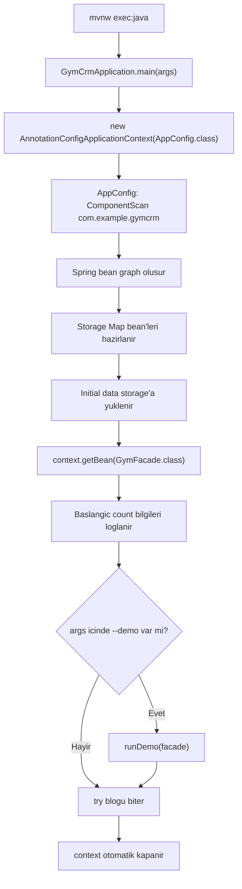

# Facade, Uygulama Girisi ve Demo Akisi

## 1. Bu Konunun Amaci

Bu notun amaci, projede dis dunyaya acilan son katmani ve uygulamanin nasil baslatildigini anlamaktir.

Bu bolumun sonunda sunlari netlestirmis olmalisin:

- Facade pattern hangi problemi cozer?
- `GymFacade` neden service katmanlarini tek bir sinir arkasinda toplar?
- Constructor injection facade icin neden temiz bir bagimlilik modelidir?
- `GymCrmApplication` Spring context'i nasil baslatir?
- `AnnotationConfigApplicationContext` ne ise yarar?
- `context.getBean(GymFacade.class)` ile Spring container'dan bean almak ne anlama gelir?
- `try-with-resources` Spring context icin neden kullanilir?
- `--demo` argumani uygulamanin davranisini nasil degistirir?
- Maven exec plugin bu projede uygulamayi nasil calistirir?
- `GymFacadeTest` ve `GymCrmApplicationTest` hangi davranislari guvence altina alir?

Bu konu, projeyi bastan sona okumak icin guzel bir kapanis noktasi gibidir. Cunku facade ve application entry point, onceki tum katmanlari bir araya getirir:

- Domain modeli
- DAO katmani
- Service katmani
- Generator'lar
- Spring Core configuration
- Initial data loading
- Logging
- Testler

## 2. Buyuk Resim

Bu proje klasik bir web uygulamasi degildir. Yani burada controller, HTTP endpoint, JSON request/response veya web server yoktur.

Uygulama bir Java main metodu ile baslar:

```text
GymCrmApplication.main(...)
```

Bu main metodu Spring context'i acar, `GymFacade` bean'ini alir ve facade uzerinden sisteme erisir.

Disaridan bakinca ana kullanim noktasi sudur:

```java
GymFacade facade = context.getBean(GymFacade.class);
```

Facade'in gorevi, kullaniciyi veya uygulama giris noktasini alt katmanlarin detaylarindan korumaktir.

Facade olmadan main metodu sunlari tek tek bilmek zorunda kalirdi:

- `TraineeService`
- `TrainerService`
- `TrainingService`
- Hangi islem hangi service'e gider?
- Hangi command nesnesi hangi service metodu ile kullanilir?
- Trainee silme, trainer guncelleme, training olusturma gibi islemler nereden cagirilir?

Facade varken main metodu sadece `GymFacade` ile konusur. Bu, uygulamanin dis sinirini daha sade ve okunabilir hale getirir.

Projede katmanlar genel olarak soyle okunabilir:

```text
GymCrmApplication
        |
        v
GymFacade
        |
        +--> TraineeService
        +--> TrainerService
        +--> TrainingService
                |
                v
              DAO
                |
                v
          Map<Long, Entity>
```

Bu zincirde `GymCrmApplication` uygulamanin baslatma kodudur. `GymFacade` ise uygulamayi kullanmak isteyen kod icin tek giris kapisidir.

## 3. Facade Pattern Temelleri

Facade pattern, karmasik bir alt sistemi daha basit bir arayuz arkasinda sunan tasarim desenidir.

Kelime anlami olarak facade, bir binanin dis yuzu gibi dusunulebilir. Disaridan bakan kisi binanin tum elektrik, tesisat, kolon, oda ve kablo yapisini gormez. Sadece giris noktalarini ve kullanmasi gereken yuzu gorur.

Yazilimda da benzer sekilde facade:

- Birden fazla alt sistemi tek yerde toplar.
- Disaridaki kodun detaylara bagimliligini azaltir.
- Uygulamanin kullanimini daha okunur hale getirir.
- Degisikliklerin yayilma alanini daraltir.
- Testlerde net bir sinir olusturur.

Bu projede alt sistemler service katmanlaridir:

- `TraineeService`
- `TrainerService`
- `TrainingService`

`GymFacade`, bu servisleri tek sinifta toplar.

### Facade Ne Degildir?

Facade her seyi yapan dev bir sinif olmamalidir.

Bu projede `GymFacade`:

- Validation yapmaz.
- Username/password uretmez.
- DAO'ya dogrudan gitmez.
- Entity iliskilerini kontrol etmez.
- Storage detaylarini bilmez.

Bunlar service ve DAO katmanlarinin sorumlulugudur.

`GymFacade` sadece public operasyonlari uygun service'e delege eder.

Bu ayrim cok onemlidir. Facade'in sade kalmasi, katmanli mimarinin bozulmamasini saglar.

### Facade Neden Tek Giris Noktasi Saglar?

Bir uygulamada farkli kullanicilar veya ust katmanlar ayni is kurallarina erismek isteyebilir.

Ornek ust katmanlar sunlar olabilir:

- `main` metodu
- CLI komutlari
- REST controller
- Masaustu arayuzu
- Test senaryolari
- Batch job

Bu ust katmanlar service'leri tek tek bilmek zorunda kalirsa coupling artar. Facade, bu ihtiyaci azaltir.

Bu projede bugun web controller yok. Ama yarin bir REST API eklenseydi, controller'lar dogrudan service'lere dagilmak yerine `GymFacade` uzerinden sisteme erisebilirdi.

## 4. Uygulama Baslatma Akisi

Uygulama giris noktasi:

```text
src/main/java/com/example/gymcrm/application/GymCrmApplication.java
```

Main metodu su isi yapar:

1. `AnnotationConfigApplicationContext` ile Spring context'i acar.
2. Context'e root configuration olarak `AppConfig.class` verir.
3. Spring, `@ComponentScan` ile proje bean'lerini bulur.
4. Storage bean'leri, DAO'lar, service'ler, generator'lar ve facade hazirlanir.
5. Initial data yukleme akisi calisir.
6. `GymFacade` bean'i context'ten alinir.
7. Baslangic count bilgileri loglanir.
8. Argumanlarda `--demo` varsa demo senaryosu calistirilir.
9. `try-with-resources` bittiginde context kapatilir.

Basit haliyle kod sunu soyler:

```java
try (AnnotationConfigApplicationContext context =
             new AnnotationConfigApplicationContext(AppConfig.class)) {
    GymFacade facade = context.getBean(GymFacade.class);

    if (Arrays.asList(args).contains("--demo")) {
        runDemo(facade);
    }
}
```

### AnnotationConfigApplicationContext

`AnnotationConfigApplicationContext`, Spring'in annotation tabanli configuration kullanan application context sinifidir.

Bu projede XML configuration yoktur. Bunun yerine Java class ve annotation kullanilir:

- `@Configuration`
- `@ComponentScan`
- `@PropertySource`
- `@Bean`
- `@Component`
- `@Service`
- `@Repository`

`new AnnotationConfigApplicationContext(AppConfig.class)` cagrisi Spring'e sunu soyler:

```text
AppConfig sinifini root configuration olarak oku, oradan bean graph'ini kur.
```

### context.getBean

Spring context acildiktan sonra `GymFacade` bean'i su sekilde alinir:

```java
GymFacade facade = context.getBean(GymFacade.class);
```

Bu noktada `GymFacade` nesnesini biz `new GymFacade(...)` ile olusturmayiz. Spring container bizim icin olusturur.

Spring bunu yaparken constructor parametrelerini de cozer:

```java
public GymFacade(TraineeService traineeService,
                 TrainerService trainerService,
                 TrainingService trainingService) {
    this.traineeService = traineeService;
    this.trainerService = trainerService;
    this.trainingService = trainingService;
}
```

Yani `GymFacade` bean'i hazir oldugunda icindeki service bagimliliklari da hazirdir.

### try-with-resources

`AnnotationConfigApplicationContext`, kapatilabilir bir resource gibi davranir. Bu yuzden `try-with-resources` ile kullanilir.

Bu yapi sayesinde blok bittiginde context otomatik kapanir.

```java
try (AnnotationConfigApplicationContext context =
             new AnnotationConfigApplicationContext(AppConfig.class)) {
    // context kullanimi
}
```

Context kapaninca Spring bean yasam dongusu de duzgun tamamlanir. Bu projede cok agir bir resource yoktur ama bu aliskanlik dogrudur.

Ozellikle gercek projelerde context icinde sunlar olabilir:

- Database connection pool
- Thread pool
- Scheduler
- Cache client
- File watcher
- Messaging connection

Bu kaynaklarin duzgun kapanmasi gerekir.

## 5. Bu Projede Nerede?

Facade sinifi:

```text
src/main/java/com/example/gymcrm/facade/GymFacade.java
```

Uygulama giris noktasi:

```text
src/main/java/com/example/gymcrm/application/GymCrmApplication.java
```

Spring root configuration:

```text
src/main/java/com/example/gymcrm/config/AppConfig.java
```

Storage bean configuration:

```text
src/main/java/com/example/gymcrm/config/StorageConfig.java
```

Facade'in kullandigi service interface'leri:

```text
src/main/java/com/example/gymcrm/service/TraineeService.java
src/main/java/com/example/gymcrm/service/TrainerService.java
src/main/java/com/example/gymcrm/service/TrainingService.java
```

Facade'in kullandigi command nesneleri:

```text
src/main/java/com/example/gymcrm/service/command/CreateTraineeCommand.java
src/main/java/com/example/gymcrm/service/command/UpdateTraineeCommand.java
src/main/java/com/example/gymcrm/service/command/CreateTrainerCommand.java
src/main/java/com/example/gymcrm/service/command/UpdateTrainerCommand.java
src/main/java/com/example/gymcrm/service/command/CreateTrainingCommand.java
```

Test dosyalari:

```text
src/test/java/com/example/gymcrm/facade/GymFacadeTest.java
src/test/java/com/example/gymcrm/application/GymCrmApplicationTest.java
```

Maven exec plugin configuration:

```text
pom.xml
```

Calistirma dokumani:

```text
README.md
```

## 6. Kod Akisi

### 6.1 Normal Calistirma Akisi

Normal calistirma komutu:

```powershell
.\mvnw.cmd exec:java
```

Bu komut Maven exec plugin'i kullanarak `GymCrmApplication.main(...)` metodunu calistirir.

Akis:



Normal calistirmada `--demo` argumani verilmez. Bu yuzden uygulama sadece context'i acar, mevcut initial data sayilarini loglar ve kapanir.

### 6.2 Demo Calistirma Akisi

Demo calistirma komutu:

```powershell
.\mvnw.cmd exec:java "-Dexec.args=--demo"
```

Bu komut main metoduna `--demo` argumanini gonderir.

Kodda kontrol su sekildedir:

```java
if (Arrays.asList(args).contains("--demo")) {
    runDemo(facade);
}
```

Burada `args` bir `String[]` dizisidir. `Arrays.asList(args)` bu diziyi liste gibi kontrol etmeyi kolaylastirir.

Demo akisi `runDemo(facade)` icinde calisir.

### 6.3 runDemo Ne Yapar?

`runDemo` metodu facade uzerinden su islemleri yapar:

1. Yeni bir trainee olusturur.
2. Bu trainee'yi gunceller.
3. Guncellenen trainee'yi siler.
4. Yeni bir trainer olusturur.
5. Trainer'i gunceller.
6. Yeni bir training olusturur.
7. Final count bilgilerini loglar.

Bu noktada dikkat edilmesi gereken sey sudur:

Demo metodu dogrudan service cagirmiyor. Tum islemleri facade uzerinden yapiyor.

Ornek:

```java
Trainee trainee = facade.createTrainee(new CreateTraineeCommand(
        "John", "Smith", LocalDate.of(2001, 1, 1), "Demo address", true));
```

Bu tek satirin arkasinda su zincir calisir:

```text
GymCrmApplication.runDemo
        |
        v
GymFacade.createTrainee
        |
        v
TraineeService.create
        |
        v
TraineeDao.save
        |
        v
traineeStorage Map
```

### 6.4 Training Demo Detayi

Demo sonunda training su command ile olusturulur:

```java
new CreateTrainingCommand(
        1L, 1L, "Demo training", TrainingType.FITNESS, LocalDate.now(), 45)
```

Burada `1L` trainee id ve `1L` trainer id anlamina gelir.

Bu kodun calisabilmesi icin initial data icinde id'si `1L` olan trainee ve trainer bulunmalidir. Training service, training olusturmadan once bu referanslarin varligini kontrol eder.

Bu davranis facade'in degil service katmaninin sorumlulugudur.

### 6.5 Context Acilisinda Neler Olur?

`AppConfig` sinifi:

```java
@Configuration
@ComponentScan("com.example.gymcrm")
@PropertySource("file:${gym.config.path:config/application.properties}")
public class AppConfig {
    @Bean
    public static PropertySourcesPlaceholderConfigurer propertySourcesPlaceholderConfigurer() {
        return new PropertySourcesPlaceholderConfigurer();
    }
}
```

Burada uc onemli nokta vardir:

- `@Configuration`: Bu sinif Spring configuration sinifidir.
- `@ComponentScan`: `com.example.gymcrm` altindaki component bean'lerini bulur.
- `@PropertySource`: property dosyasini yukler.

`StorageConfig` da `@Configuration` oldugu icin component scan ile bulunur ve su storage bean'lerini uretir:

- `traineeStorage`
- `trainerStorage`
- `trainingStorage`

Bu bean'ler daha sonra DAO katmanina enjekte edilir.

## 7. GymFacade Constructor Injection ve Delegation

`GymFacade` sinifi `@Component` ile isaretlidir:

```java
@Component
public class GymFacade {
    private final TraineeService traineeService;
    private final TrainerService trainerService;
    private final TrainingService trainingService;
}
```

Bu annotation sayesinde Spring component scan sirasinda `GymFacade` sinifini bean olarak kaydeder.

Constructor:

```java
public GymFacade(TraineeService traineeService,
                 TrainerService trainerService,
                 TrainingService trainingService) {
    this.traineeService = traineeService;
    this.trainerService = trainerService;
    this.trainingService = trainingService;
}
```

Bu constructor injection ornegidir.

Constructor injection'in avantajlari:

- Bagimliliklar nesne olusurken zorunlu hale gelir.
- `final` alanlar kullanilabilir.
- Sinif eksik bagimlilikla yarim hazir durumda kalmaz.
- Unit testlerde mock service'ler kolay verilir.
- Kodun neye ihtiyac duydugu constructor imzasindan okunur.

Facade metodlari ise kisa delegation metodlaridir.

Ornek:

```java
public Trainee createTrainee(CreateTraineeCommand command) {
    return traineeService.create(command);
}
```

Bu metodun yaptigi is:

```text
Facade'e gelen create trainee istegini TraineeService'e ilet.
Service'ten donen sonucu aynen geri don.
```

### Delegation Tablosu

| Facade metodu | Delege edilen service metodu | Sorumluluk |
| --- | --- | --- |
| `createTrainee(command)` | `traineeService.create(command)` | Trainee olusturma |
| `updateTrainee(id, command)` | `traineeService.update(id, command)` | Trainee guncelleme |
| `deleteTrainee(id)` | `traineeService.delete(id)` | Trainee silme |
| `findTrainee(id)` | `traineeService.findById(id)` | Tek trainee bulma |
| `findAllTrainees()` | `traineeService.findAll()` | Tum trainee listesini alma |
| `createTrainer(command)` | `trainerService.create(command)` | Trainer olusturma |
| `updateTrainer(id, command)` | `trainerService.update(id, command)` | Trainer guncelleme |
| `findTrainer(id)` | `trainerService.findById(id)` | Tek trainer bulma |
| `findAllTrainers()` | `trainerService.findAll()` | Tum trainer listesini alma |
| `createTraining(command)` | `trainingService.create(command)` | Training olusturma |
| `findTraining(id)` | `trainingService.findById(id)` | Tek training bulma |
| `findAllTrainings()` | `trainingService.findAll()` | Tum training listesini alma |

Tablodan goruldugu gibi facade icinde is kurali yoktur. Bu bilerek yapilmistir.

## 8. Kisa Kod Okuma Notlari

### 8.1 `GymFacade` Kodunu Okurken

`GymFacade` dosyasini okurken kendine su sorulari sor:

- Sinif hangi annotation ile Spring bean oluyor?
- Hangi service interface'lerine bagimli?
- Constructor parametreleri ile field'lar bire bir eslesiyor mu?
- Public metotlar hangi service metodlarina gidiyor?
- Facade icinde validation, mapping veya storage detayi var mi?

Bu sorularin cevaplari facade'in mimari rolunu netlestirir.

### 8.2 `GymCrmApplication` Kodunu Okurken

`GymCrmApplication` dosyasinda once sinif yapisina bak:

```java
public final class GymCrmApplication {
    private static final Logger LOGGER = LoggerFactory.getLogger(GymCrmApplication.class);

    private GymCrmApplication() {
    }
}
```

Bu sinif utility/entry point gibi davranir:

- `final` oldugu icin extend edilmez.
- Constructor `private` oldugu icin instance alinmaz.
- `main` static oldugu icin JVM tarafindan calistirilir.

Sonra main metodunu oku:

- Context nerede aciliyor?
- Facade nereden aliniyor?
- Log satiri hangi bilgileri yaziyor?
- `--demo` kontrolu nasil yapiliyor?
- Context nerede kapaniyor?

### 8.3 Logger Kullanimi

Application sinifi `System.out.println` yerine SLF4J logger kullanir:

```java
private static final Logger LOGGER = LoggerFactory.getLogger(GymCrmApplication.class);
```

Log satirlarinda placeholder kullanilir:

```java
LOGGER.info("Gym CRM started: trainees={}, trainers={}, trainings={}",
        facade.findAllTrainees().size(),
        facade.findAllTrainers().size(),
        facade.findAllTrainings().size());
```

Bu kullanim string concat yapmaktan daha temizdir ve log framework'u ile uyumludur.

### 8.4 `--demo` Argumani

`--demo`, uygulamanin normal baslatma davranisina ek bir senaryo ekler.

Arguman verilmezse:

```text
Context acilir -> count loglanir -> context kapanir
```

Arguman verilirse:

```text
Context acilir -> count loglanir -> demo islemleri calisir -> context kapanir
```

Bu basit ama guzel bir pattern'dir. Uygulamanin tek main metodu vardir, ama argumanla farkli calisma modu secilebilir.

### 8.5 Maven Exec Plugin

`pom.xml` icinde exec plugin su sekilde tanimlidir:

```xml
<plugin>
    <groupId>org.codehaus.mojo</groupId>
    <artifactId>exec-maven-plugin</artifactId>
    <version>3.5.0</version>
    <configuration>
        <mainClass>com.example.gymcrm.application.GymCrmApplication</mainClass>
    </configuration>
</plugin>
```

Bu configuration Maven'a su bilgiyi verir:

```text
exec:java hedefi calisinca su main class'i baslat.
```

Bu sayede komut kisa kalir:

```powershell
.\mvnw.cmd exec:java
```

Main class'i her seferinde komutta yazman gerekmez.

Demo argumani vermek icin:

```powershell
.\mvnw.cmd exec:java "-Dexec.args=--demo"
```

Property dosyasi degistirmek icin:

```powershell
.\mvnw.cmd -Dgym.config.path=C:\path\application.properties exec:java
```

Bu komut `AppConfig` icindeki su property source ile iliskilidir:

```java
@PropertySource("file:${gym.config.path:config/application.properties}")
```

Eger `gym.config.path` verilirse o dosya kullanilir. Verilmezse default olarak `config/application.properties` kullanilir.

### 8.6 Testleri Okurken

Bu konuyu calisirken iki test dosyasi ozellikle onemlidir:

```text
src/test/java/com/example/gymcrm/facade/GymFacadeTest.java
src/test/java/com/example/gymcrm/application/GymCrmApplicationTest.java
```

`GymFacadeTest`, facade'in tum public operasyonlari dogru service metoduna delege ettigini kontrol eder.

Testte gercek service implementasyonlari kullanilmaz. Bunun yerine Mockito mock'lari kullanilir:

```java
TraineeService traineeService = mock(TraineeService.class);
TrainerService trainerService = mock(TrainerService.class);
TrainingService trainingService = mock(TrainingService.class);
GymFacade facade = new GymFacade(traineeService, trainerService, trainingService);
```

Bu tercih testin kapsamini net tutar. `GymFacadeTest`, service davranisini tekrar test etmek istemez. Sadece facade'in dogru servisleri cagirdigini test eder.

Ornek dogrulama:

```java
assertThat(facade.createTrainee(createTrainee)).isSameAs(trainee);
```

Bu assertion sunu soyler:

```text
traineeService.create(createTrainee) ne donduruyorsa facade.createTrainee de onu dondurmeli.
```

Silme islemi icin donus degeri olmadigindan `verify` kullanilir:

```java
facade.deleteTrainee(1L);
verify(traineeService).delete(1L);
```

Bu da facade'in delete istegini `traineeService.delete(1L)` metoduna ilettigini dogrular.

`GymCrmApplicationTest` ise iki senaryoyu kontrol eder:

```java
GymCrmApplication.main(new String[0])
GymCrmApplication.main(new String[]{"--demo"})
```

AssertJ ile ana beklenti sudur:

```java
assertThatCode(() -> GymCrmApplication.main(new String[0]))
        .doesNotThrowAnyException();
```

Bu test bir smoke test gibi okunabilir. Yani ana soru sudur:

```text
Uygulama context'i acip kapatabiliyor mu?
Demo senaryosu patlamadan calisiyor mu?
```

Bu test her is kuralini detayli test etmez. Zaten service testleri o isi yapar. Ama Spring wiring, application startup ve demo akisindaki bariz kopukluklari yakalamak icin degerlidir.

## 9. Sik Dusulen Hatalar

### Facade Icinde Is Kurali Yazmak

Yanlis egilim:

```text
createTraining icinde trainee var mi, trainer var mi diye facade kontrol etsin.
```

Bu projede dogru yer service katmanidir. Facade sadece uygun service metodunu cagirir.

Facade icinde is kurali birikmeye baslarsa service katmaninin anlami zayiflar.

### Facade'i DAO'ya Baglamak

Facade'in DAO ile konusmasi katmanlari atlamak olur.

Dogru akis:

```text
Facade -> Service -> DAO
```

Riskli akis:

```text
Facade -> DAO
```

DAO storage detaylarini bilir. Facade bu detayi bilmemelidir.

### `new GymFacade(...)` ile Application Icinde Nesne Uretmek

`GymCrmApplication` icinde facade'i manuel uretmek yanlis olurdu:

```java
GymFacade facade = new GymFacade(...);
```

Cunku bu durumda service bagimliliklarini da manuel kurmak gerekir. Spring container'in asil gorevi zaten bu object graph'i kurmaktir.

Bu projede dogru kullanim:

```java
GymFacade facade = context.getBean(GymFacade.class);
```

### Context'i Kapatmamak

Spring context acilip kapatilmazsa kaynaklar temizlenmeyebilir.

Bu projede `try-with-resources` bunu otomatik cozer.

### Demo Kodunu Test Yerine Koymak

`--demo` akisi uygulamayi elle gormek icin faydalidir ama testin yerine gecmez.

Demo:

- Uygulamayi calistirir.
- Loglardan akisi gosterir.
- Ornek senaryo sunar.

Test:

- Davranisi otomatik dogrular.
- Build sirasinda calisir.
- Regression yakalar.

Bu yuzden `GymCrmApplicationTest` ayrica vardir.

### Command Nesnelerini Atlamak

Facade metotlari domain nesnesi yerine command nesnesi alir:

```java
createTrainee(CreateTraineeCommand command)
```

Bu iyi bir ayrimdir. Disaridan gelen istek ile sistemin sakladigi entity ayni sey degildir.

Yeni kayit olustururken `id`, `username`, `password` gibi alanlar kullanicidan gelmez; service tarafindan uretilir veya atanir.

## 10. Kendini Test Et

1. Facade pattern'in temel amaci nedir? Bu projede hangi alt sistemleri sade bir arayuz arkasinda toplar?

2. `GymFacade` neden `@Component` ile isaretlenmistir? Bu annotation olmazsa `context.getBean(GymFacade.class)` cagrisi nasil etkilenir?

3. `GymFacade` constructor'inda neden interface tipleri kullaniliyor: `TraineeService`, `TrainerService`, `TrainingService`?

4. Constructor injection'in field injection'a gore bu sinifta hangi avantajlari vardir?

5. `GymFacade.createTrainee(...)` metodunda validation yapilmamasinin sebebi nedir?

6. `GymCrmApplication` neden `AnnotationConfigApplicationContext(AppConfig.class)` ile baslar?

7. `try-with-resources` Spring context icin neyi garanti eder?

8. `--demo` argumani verilince normal uygulama akisina ek olarak hangi metod calisir?

9. Maven exec plugin icindeki `mainClass` ayari olmazsa `.\mvnw.cmd exec:java` komutu neden eksik kalabilir?

10. `GymFacadeTest` neden gercek service implementasyonlari yerine mock service kullanir?

11. `GymCrmApplicationTest` neden detayli assertion'lar yapmak yerine "exception firlatmiyor" kontrolu yapar?

12. Demo akisi training olustururken neden `1L` trainee id ve `1L` trainer id kullanir? Bu id'ler yoksa ne olmasini beklersin?

## 11. Mini Pratik

1. `GymFacade.java` dosyasini ac ve her public metodun hangi service metoduna gittigini kendin tablo olarak yaz. Sonra bu tabloyu `GymFacadeTest` icindeki assertion'larla karsilastir.

2. `GymCrmApplication.main(...)` icindeki akisi kagida veya not defterine su basliklarla cikar: context acilis, bean alma, logging, demo kontrolu, context kapanis.

3. `.\mvnw.cmd exec:java` komutunu calistir ve loglarda gorunen trainee/trainer/training sayilarini not al. Sonra `.\mvnw.cmd exec:java "-Dexec.args=--demo"` komutunu calistir ve demo loglarini onceki calistirma ile karsilastir.

4. `GymFacadeTest` icinde sadece bir delegation assertion'ini yorum satiri yapmayi dusun. Hangi davranisin artik test edilmedigini kendi cumlenle acikla. Kodu kalici olarak degistirme.

5. `GymCrmApplicationTest` icindeki `applicationRunsDemoScenario` testini oku. Demo akisinin patlamadan calismasi hangi alt katmanlarin birlikte dogru baglandigina isaret eder?

6. `pom.xml` icindeki exec plugin configuration'ini bul. `mainClass` degerinin hangi Java dosyasina karsilik geldigini dosya yolu olarak yaz.

## 12. Mulakat / Sinav Sorulari

1. Facade pattern nedir? Adapter veya service layer ile karistirilmamasi icin nasil aciklarsin?

2. Bir facade sinifinin icinde business logic bulunmasi hangi durumlarda sorun yaratir?

3. Constructor injection, setter injection ve field injection arasindaki farklari anlat. `GymFacade` icin hangisi daha uygundur?

4. Spring `ApplicationContext` nedir? `AnnotationConfigApplicationContext` hangi configuration stilini destekler?

5. `context.getBean(GymFacade.class)` cagrisi ile `new GymFacade(...)` arasindaki temel fark nedir?

6. `try-with-resources` hangi Java mekanizmasina dayanir? Spring context'in kapatilmasi neden onemlidir?

7. Command nesnesi ile domain entity arasindaki fark nedir? Facade neden create/update islemlerinde command alir?

8. Smoke test nedir? `GymCrmApplicationTest` neden smoke test karakteri tasir?

9. Mockito ile mock service kullanmak facade testinde hangi izolasyonu saglar?

10. CLI argumanlari ile uygulama davranisi degistirmek hangi durumlarda faydalidir? `--demo` bunun basit bir ornegi olarak nasil calisir?

11. Bir projeye daha sonra REST controller eklense, controller'larin facade kullanmasi hangi avantajlari saglayabilir?

12. Maven exec plugin olmadan bu uygulamayi calistirmak icin hangi bilgileri manuel vermen gerekirdi?

## 13. Ozet

Bu projede `GymFacade`, uygulamanin service katmanlarini disaridan daha sade kullanilabilir hale getiren tek giris noktasidir. `TraineeService`, `TrainerService` ve `TrainingService` bagimliliklarini constructor injection ile alir ve public metotlarinda istekleri ilgili service'e delege eder.

`GymFacade` is kurali yazmaz, validation yapmaz, DAO'ya gitmez ve storage detayi bilmez. Bu sayede katmanli mimari temiz kalir: facade dis siniri sade tutar, service is kurallarini uygular, DAO storage ile calisir.

`GymCrmApplication`, uygulamanin Java main girisidir. `AnnotationConfigApplicationContext(AppConfig.class)` ile Spring context'i acar, `GymFacade` bean'ini alir, baslangic sayilarini loglar ve `--demo` argumani varsa demo senaryosunu calistirir. `try-with-resources` sayesinde context is bitince otomatik kapanir.

Maven exec plugin, `GymCrmApplication` sinifini main class olarak tanimladigi icin uygulama `.\mvnw.cmd exec:java` komutu ile kolayca calistirilir. Demo modu icin `.\mvnw.cmd exec:java "-Dexec.args=--demo"` kullanilir.

`GymFacadeTest`, facade'in tum public operasyonlari dogru service metodlarina delege ettigini mock service'ler ile izole sekilde test eder. `GymCrmApplicationTest` ise uygulamanin normal ve demo modunda context acip kapatabildigini, yani wiring ve baslatma akisinin patlamadan calistigini dogrular.
